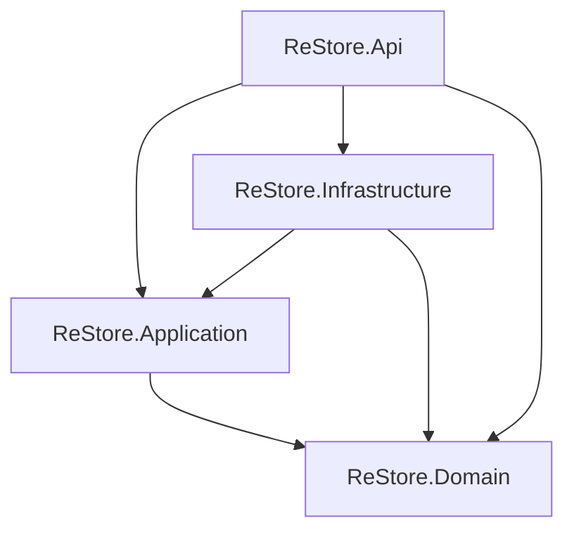

# ReStore architecture

This describes the implemented code after backend Phases 0–8 and React Phase 8a.
For wire examples, see [API contracts](api-contracts.md). The
[port plan](cqrs-port-plan.md) records the decisions and execution history.

## Layers and dependencies



These arrows are project references, not a requirement that feature controllers
call Infrastructure. The API composition root wires implementations; feature
controllers dispatch commands/queries through MediatR.

| Layer | Owns | Boundary |
| --- | --- | --- |
| Domain | Entities/aggregates, keys, domain responses, repository contracts, RequestConfig | No EF Core or HTTP dependency; Identity entities use Identity store abstractions |
| Application | Request/response types, handlers, Controls, filter expressions and integration interfaces | No MVC, EF Core, Stripe or Cloudinary types |
| Infrastructure | StoreContext/migrations, repositories, mapping, Identity and external adapters | Implements Application/Domain interfaces |
| Api | Binding, HTTP identity/cookies, JWT authentication, middleware, MCP and composition | Business handlers do not receive HttpContext or IFormFile |
| client | API adapters, Redux state, forms and UI | Checks envelope `succeeded`, normalizes responses before updating state |

The test project references the API as well as the libraries so it can exercise
the HTTP shell. Production projects do not reference tests.

## Composition and request flow

`Program.cs` calls `AddApplication`, `AddInfrastructure`, `AddApiServices`,
`InitializeDatabaseAsync` and `UseApi`.

- Application registration scans its assembly for MediatR handlers.
- Infrastructure registers the scoped DbContext, repositories, Controls, mapping,
  Identity and external adapters. Cache/bus no-op implementations remain active.
- API registration configures controllers, Swagger, MCP, JWT, CORS, health checks
  and the HTTP implementation of IBuyerIdentity.
- Initialization attempts EF migrations and demo initialization. Failure is logged
  without preventing liveness; `/health/db` reports database readiness separately.

A normal request is:

```text
HTTP binding or MCP arguments
  -> MediatR command/query
  -> handler and feature Controls
  -> repository / Identity / storage / payment interface
  -> Infrastructure implementation
  -> envelope
```

Controllers usually bind the command/query directly. Product create/update use
multipart adapters to convert IFormFile to the command’s Stream. The ZarinPal
callback reads the authority and status from the query string.

## CQRS kernel

The six template handlers cover add, update, delete, inactive, list and detail
operations. Constructor injection replaces the AccountsApi service locator.
Features override the hooks they need; aggregate workflows are not forced through
single-row CRUD.

Query handlers build RequestConfig criteria, projection, ordering and paging.
The generic query repository uses AsNoTracking and projects selected columns to
anonymous objects, maps the partial shape back to an entity, and then produces DTOs.
Projection and DTO changes therefore need behavioural verification, not just a build.

The generic command repository writes only `ChangeFields` for updates. Mapster's
IgnoreNullValues prevents omitted nullable command values from blanking the loaded
entity. The selected column list, not IgnoreNullValues alone, determines which
columns are written. An optional afterSave callback runs inside the repository's
transaction and may cause rollback. AddRange currently performs per-entity writes;
it is not an atomic batch operation.

Generic write methods clear the context's change tracker on completion. Do not
chain them to assemble a multi-entity checkout: use one dedicated repository owning
the whole operation, as Orders does. There is no imported UnitOfWork implementation
or separate read-replica DbContext.

### Controls, keys and filters

BaseControls loads the existing row and performs ControlAttribute validation;
specific Controls own feature rules. ProductControls defines product rules,
OrderControls checks checkout baskets and stock. ZarinPal uses the saved order total.
Identity uses UserManager for user validation.

EntityKeyResolver reads EF metadata. The renamed commerce keys are ProductId,
BasketId, BasketItemId, OrderId and OrderItemId, with explicit Key attributes.
CheckKeyExistsAttribute identifies a repository type; Infrastructure performs the
lookup before the base add handler maps/writes the entity.

The filter engine supports all 14 eFilterType values, with ftWordtoWord treated as
equality. Filters in the same nonzero InnerFilterId are ORed; groups and independent
filters are ANDed. Names refer to entity properties. Unknown columns and invalid
operator/value combinations produce failures. This is not a separate DTO-level
column-exposure whitelist. The existing React UI uses the catalog's dedicated
search/brand/type/sort parameters, not a generic grid; arbitrary filter-value HTTP
binding should be exercised before adding such a consumer.

The generic ordering path rejects unknown columns. Products additionally translates
the UI keys `price`/`priceDesc`; other orderBy strings currently fall back to name
order. That feature mapping is distinct from generic OrderInfo column validation.

## Feature workflows

### Products and images

Products is the reference base-handler slice. List DTOs omit the description;
detail DTOs include it. The React detail page and inventory editor fetch the full
record when given a summary. Images pass through IImageStorage/Cloudinary.
Successful image replacement deletes the old image after the database update.
Image operations are not part of the database transaction; orphan-image cleanup
after a failed operation is not a durable subsystem in this implementation.

### Basket and buyer identity

HttpBuyerIdentity uses the authenticated name, otherwise the `buyerId` cookie.
AnonymousBuyerId exposes that cookie independently for login transfer. Only the
HTTP adapter creates/deletes cookies; Application uses the interface.

BasketRepository loads tracked items/products, invokes aggregate AddItem/RemoveItem
and saves. Repeated products share a line; over-removal clears it. Missing baskets
are successful null results, while database failures remain failures. The React
client applies the returned basket after mutations rather than reimplementing the
quantity calculation.

### Checkout transaction

OrderRepository owns one serializable transaction and one SaveChanges for creating
the order and item/address/price snapshots, decrementing stock, deleting the basket
and optionally creating/updating the saved user address. OrderControls runs before
stock mutation. Generic write repositories are not called within this operation.
Failure rolls back the database work; serializable conflicts fail without an
automatic checkout retry.

Amounts use integer minor units. Delivery is 500 unless subtotal is strictly
greater than 10000. OrderDate defaults to UTC for PostgreSQL timestamp-with-time-zone.
Reads always add the authenticated buyer criterion, including detail-by-id reads;
client filters cannot remove it.

### Account and guest transfer

IIdentityService wraps UserManager and registration persistence. User creation and
Member assignment are transactional. ITokenGenerator issues HS512 tokens with
name/email/role claims and a seven-day UTC expiry.

Login uses the stored canonical username. To preserve the previous behaviour, an
existing guest basket **replaces**, rather than combines with, the old account
basket. Transfer/deletion is serializable, only GUID-shaped guest IDs are eligible,
and cookie deletion follows success. Without a guest basket the account basket is
retained. Token generation precedes transfer so a signing failure cannot consume
the guest basket.

### ZarinPal checkout

Checkout first snapshots the buyer’s basket in a pending order. The buyer and checkout UUID identify retries.
The ZarinPal service uses the saved rial total and persists the gateway authority before returning a redirect.
The storefront submits the callback to the API, which verifies with ZarinPal and commits the payment result,
order status and any stock deduction together. A repeat callback reads the stored result.
Historical orders and their payment identifiers remain readable.

## HTTP response policy

EnvelopeResponseAttribute is explicit endpoint metadata on business controllers or
actions. MVC uses it for binding/validation failures and ExceptionMiddleware uses
it for unhandled exceptions. It is not a response wrapper, authorization attribute
or business validator; handlers already return their own envelopes.

The attribute is absent from BaseApiController, BuggyController and the health endpoints.
The frontend error demonstrations and authentication failures retain their HTTP statuses. Production unhandled exceptions are sanitized. This does not mean every
handler-provided error string is sanitized: some repository failures still carry
provider wording in the failed envelope.

## Authorization boundaries

HTTP product writes require Admin; Orders, current-user/address and payment-link
routes require authentication. Basket routes permit guests. Handler-level buyer
guards also protect account/order/payment workflows.

The `/mcp` endpoint currently uses AllowAnonymous. Its product tools call MediatR
directly and do not inherit controller authorization. In particular, the Admin
attribute on HTTP product mutations is not enforced by the product command handlers
when invoked through MCP. This is an existing exposure boundary, not proof of
HTTP/MCP authorization parity; it needs an explicit policy before a trusted-demo
endpoint is exposed more widely.

## Persistence and optional infrastructure

One scoped StoreContext provides PostgreSQL persistence and Identity storage. The
entity/key rename migration uses five RenameColumn operations, preserving physical
table names. Identity names/tables and historical migration IDs remain unchanged.
The source namespace `OrderAggregare` still retains its historical spelling; the
earlier plan's spelling cleanup was not implemented.

Runtime does not require Redis/RabbitMQ. NullCache and NullMessageBus are registered;
real adapters/settings are present but inactive. Activation and degraded-mode checks
are described in the [switch-on runbook](cqrs-port-plan.md). No cache invalidation,
event-consumer topology or durable outbox should be inferred from those seams alone.

## Verification and maintenance

The recorded checks are 136 backend tests and 23 client tests, plus TypeScript and
the production client/API builds. SQLite covers relational repository behaviour
and rollback; HTTP-shell tests exercise MVC/auth/error policy with a controlled
mediator. Client tests use controlled HTTP responses for payment-link retry and checkout results. Backend slice tests cover the real
feature handlers independently.

When adding a feature, place its contract and rules in Application, implement its
persistence/external interfaces in Infrastructure, register it in the composition
root and keep HTTP types in Api. Use a dedicated repository when one operation
owns multiple writes. Preserve deliberate Buggy responses and verify endpoint
binding as well as handler behaviour when a wire contract changes.

## Remaining verification

- Apply the rename migration to a backed-up representative PostgreSQL database;
  check schema/data preservation and startup/health behaviour.
- Exercise simultaneous checkouts against PostgreSQL, including serializable
  conflicts and the absence of unintended retries or stock loss.
- Run a complete browser purchase against the ZarinPal Sandbox using PostgreSQL.
- Decide/enforce the MCP authorization policy for externally reachable mutation
  tools; do not rely on HTTP controller attributes to cover them.
- Validate image upload/replacement/failure handling against configured storage.
- Build/deploy the image with matching API/client revisions and verify the preserved
  error-demo routes. Historical deployment records are not validation of this refactor.
- Activate Redis/RabbitMQ only when their servers and concrete use cases are ready;
  verify operation with dependencies down before enabling them in deployment.
